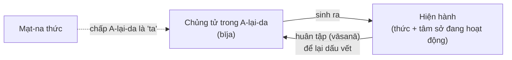

# Duy Thức Tông (Du-già Hành Phái)

*Yogācāra* / *Vijñānavāda* / *Vijñaptimātratā* — Hán: 唯識宗 (Duy Thức tông), 法相宗 (Pháp Tướng tông), 瑜伽行派 (Du-già hành phái)

**Ngày tạo:** 2026-10-26 · **Cập nhật:** 2026-10-26

> *“Thị chư thức chuyển biến, phân biệt sở phân biệt; do thử bỉ giai vô, cố nhất thiết duy thức.”*
> “Các thức chuyển biến thành cái phân biệt và cái bị phân biệt; vì vậy cả hai (ngã và pháp như ta chấp) đều không thật — nên nói tất cả là duy thức.”
> — Thế Thân, *Duy Thức Tam Thập Tụng*, tụng 17 (bản Hán của Huyền Trang, T1586)

## Tên gọi

| Tên | Nghĩa | Nhấn mạnh |
|---|---|---|
| **Yogācāra** (Du-già hành) | “Những người thực hành du-già (thiền định)” | Nguồn gốc là kinh nghiệm thiền quán, không phải lý thuyết suông |
| **Vijñānavāda** (Thức luận) | “Học thuyết về thức” | Tên do các trường phái khác (nhất là trong văn hiến luận lý) gọi |
| **Vijñaptimātratā** (Duy thức tánh, Duy biểu) | “Chỉ là biểu hiện / biểu tượng (*vijñapti*)” | Điều ta kinh nghiệm chỉ là cái được thức biểu hiện ra |
| **Cittamātra** (Duy tâm) | “Chỉ là tâm” | Tên phổ biến trong phân loại học thuyết (*siddhānta*) Tây Tạng |
| **Pháp Tướng tông** | Tông nghiên cứu “tướng” của các pháp | Tên tông phái tại Trung Hoa, Nhật Bản (Hossō) |

> Lưu ý: *vijñapti* (biểu) khác *vijñāna* (thức). Thích Nhất Hạnh dịch *vijñaptimātra* là **“Duy Biểu”** để tránh hiểu lầm rằng “chỉ có cái thức như một thực thể”.

---

## 1. Bối cảnh và lịch sử

### Vì sao Duy Thức ra đời?
Khoảng thế kỷ II, **Trung Quán** (Long Thọ) chủ trương mọi pháp đều **không có tự tánh**. Một số người tu hiểu lệch thành **hư vô** (“không có gì cả”). Duy Thức xuất hiện vừa để:
1. **Giải thích tích cực** cơ chế của mê và ngộ: nếu không có ngã, thì nghiệp được lưu giữ ở đâu? Ký ức, tái sinh, sự liên tục của tâm sau khi xuất khỏi diệt tận định (*nirodha-samāpatti*) được giải thích thế nào?
2. **Hệ thống hóa** kinh nghiệm thiền định: trong thiền, hành giả thấy các hình ảnh (*nimitta*) hoàn toàn do tâm tạo ra — từ đó đặt câu hỏi về bản chất của mọi đối tượng nhận thức.
3. **Kế thừa và cải cách Abhidharma** của các bộ phái (đặc biệt Nhất Thiết Hữu bộ và Kinh Lượng bộ) trong khung Đại thừa.

### Kinh điển nền tảng
| Kinh | Nội dung chính |
|---|---|
| **Giải Thâm Mật Kinh** (*Saṃdhinirmocana Sūtra*, T676) | Lần đầu trình bày rõ **A-đà-na / A-lại-da thức**, **tam tướng**, **tam vô tánh**; thuyết **ba thời chuyển pháp luân**: (1) Tứ Đế — “hữu”, (2) Bát-nhã — “không”, (3) Giải Thâm Mật — trung đạo, **liễu nghĩa** |
| **Kinh Hoa Nghiêm** (phẩm *Thập Địa*) | Câu thường dẫn: “Tam giới duy tâm” (三界唯心) |
| **Kinh Lăng-già** (*Laṅkāvatāra Sūtra*, T670–672) | Tám thức; kết hợp A-lại-da với **Như Lai tạng**; ảnh hưởng lớn đến Thiền tông sơ kỳ |

### Các luận sư Ấn Độ
| Thời kỳ | Nhân vật | Tác phẩm / đóng góp |
|---|---|---|
| ~TK IV | **Di-lặc** (*Maitreya / Maitreyanātha*) — truyền thống xem là Bồ-tát; học giả hiện đại tranh luận đây là nhân vật lịch sử hay danh hiệu | *Biện Trung Biên Luận* (*Madhyāntavibhāga*, T1600), *Đại Thừa Trang Nghiêm Kinh Luận* (*Mahāyānasūtrālaṃkāra*); Hán truyền gán cả *Du-già Sư Địa Luận* |
| ~TK IV | **Vô Trước** (*Asaṅga*) | *Nhiếp Đại Thừa Luận* (*Mahāyānasaṃgraha*, T1594), *Đại Thừa A-tỳ-đạt-ma Tập Luận* (*Abhidharmasamuccaya*); Tạng truyền gán *Du-già Sư Địa Luận* (*Yogācārabhūmi*, T1579) — bộ bách khoa 100 quyển về các địa tu tập |
| ~TK IV–V | **Thế Thân** (*Vasubandhu*), em của Vô Trước | Trước theo Hữu bộ/Kinh Lượng bộ, viết *Câu-xá Luận*; sau theo Đại thừa: *Duy Thức Nhị Thập Luận* (*Viṃśatikā*, T1590), *Duy Thức Tam Thập Tụng* (*Triṃśikā*, T1586), *Tam Tự Tánh Luận* (*Trisvabhāvanirdeśa*), *Đại Thừa Bách Pháp Minh Môn Luận* (T1614), *Đại Thừa Ngũ Uẩn Luận* |
| ~TK V–VI | **Trần-na** (*Dignāga*) | Nhân minh học (luận lý, nhận thức luận); *Quán Sở Duyên Duyên Luận* (*Ālambanaparīkṣā*) |
| ~TK VI | **An Huệ** (*Sthiramati*) | Chú giải *Tam Thập Tụng* (còn bản Sanskrit); khuynh hướng “vô tướng” |
| ~TK VI | **Hộ Pháp** (*Dharmapāla*) | Chú giải *Tam Thập Tụng* — làm nền cho *Thành Duy Thức Luận*; thuyết **tứ phần** |
| TK VI–VII | **Giới Hiền** (*Śīlabhadra*) | Viện chủ Nālandā, thầy của Huyền Trang |
| ~TK VII | **Pháp Xứng** (*Dharmakīrti*) | Hoàn thiện lượng học (*pramāṇa*) trên nền Kinh Lượng bộ – Duy Thức |
| TK VIII | **Tịch Hộ** (*Śāntarakṣita*), **Liên Hoa Giới** (*Kamalaśīla*) | Tổng hợp **Du-già Hành – Trung Quán** (*Yogācāra-Madhyamaka*); truyền vào Tây Tạng |

> Học giả Erich Frauwallner từng nêu giả thuyết có **hai Thế Thân** (một tác giả *Câu-xá*, một tác giả Duy Thức); nhiều học giả hiện nay (như Jonathan Gold) nghiêng về một Thế Thân duy nhất. Niên đại hai anh em vẫn còn tranh luận.

### Truyền sang Đông Á
- **Địa Luận tông** (TK VI) — dựa trên *Thập Địa Kinh Luận* của Thế Thân; chia hai phái Nam – Bắc về việc A-lại-da là chân hay vọng.
- **Nhiếp Luận tông** — **Chân Đế** (*Paramārtha*, 499–569) dịch *Nhiếp Đại Thừa Luận*; lập **thức thứ chín**: **A-ma-la thức** (*amala-vijñāna*, “thức vô cấu”), tức tâm thanh tịnh.
- **Pháp Tướng tông** — **Huyền Trang** (602–664) sang Ấn Độ (629–645), học với Giới Hiền ở Nālandā; về dịch *Du-già Sư Địa Luận* và soạn **_Thành Duy Thức Luận_** (T1585): tổng hợp mười bản chú giải *Tam Thập Tụng*, lấy quan điểm Hộ Pháp làm chính. Đệ tử **Khuy Cơ** (632–682) viết *Thành Duy Thức Luận Thuật Ký*, được xem là sơ tổ Pháp Tướng tông.
- Tông này suy sau thời Đường, nhưng **tư tưởng Duy Thức** thấm vào Hoa Nghiêm, Thiên Thai, Thiền. Ở Nhật, **Hossō** vẫn tồn tại (chùa Kōfuku-ji, Yakushi-ji ở Nara).
- **Phục hưng cận đại** (Trung Hoa, đầu TK XX): Dương Văn Hội, Âu Dương Cánh Vô, Thái Hư, Hùng Thập Lực.

### Tây Tạng
Trong hệ thống phân loại học thuyết (*grub mtha'*), **Duy Tâm** (*Cittamātra*) được xếp dưới **Trung Quán**. Tuy vậy, giáo lý tám thức, tam tánh và thiền quán Du-già vẫn được học kỹ; dòng **Jonang** (Dolpopa) với thuyết **Tha không** (*gzhan stong*) chịu ảnh hưởng sâu của Duy Thức và Như Lai tạng.

---

## 2. Giáo lý cốt lõi

### 2.1. Tám thức (Bát thức)

| # | Tên | Sanskrit | Chức năng |
|---|---|---|---|
| 1–5 | **Tiền ngũ thức**: nhãn, nhĩ, tỷ, thiệt, thân thức | *cakṣur-, śrotra-, ghrāṇa-, jihvā-, kāya-vijñāna* | Biết trực tiếp sắc, thanh, hương, vị, xúc |
| 6 | **Ý thức** | *mano-vijñāna* | Phân biệt, suy nghĩ, khái niệm hóa; biết cả quá khứ, vị lai, pháp trừu tượng |
| 7 | **Mạt-na thức** (ý căn, nhiễm ô ý) | *manas* / *kliṣṭa-manas* | **Hằng thẩm tư lương**: liên tục, vi tế chấp “kiến phần” của A-lại-da làm **ngã**; luôn đi cùng **bốn phiền não**: ngã si, ngã kiến, ngã mạn, ngã ái |
| 8 | **A-lại-da thức** (tàng thức) | *ālaya-vijñāna* | Kho chứa **chủng tử** của mọi kinh nghiệm; nền tảng của thân, căn và thế giới; “**hằng chuyển như bộc lưu**” — trôi chảy liên tục như dòng thác (*Tam Thập Tụng*, tụng 4) |

Tên khác của thức thứ tám: **Dị thục thức** (*vipāka-vijñāna* — quả chín của nghiệp), **A-đà-na thức** (*ādāna-vijñāna* — thức chấp trì, giữ gìn thân và chủng tử), **Nhất thiết chủng thức**. *Thành Duy Thức Luận* giải thích chữ “tàng” theo ba nghĩa: **năng tàng** (chứa), **sở tàng** (được huân vào), **ngã ái chấp tàng** (bị Mạt-na chấp làm ngã).

*Tam Thập Tụng* gom tám thức thành **ba năng biến** (tụng 1–2): (1) **Dị thục** = thức thứ 8, (2) **Tư lương** = thức thứ 7, (3) **Liễu biệt cảnh** = sáu thức trước.

> **Cảnh báo ngay trong kinh** — *Giải Thâm Mật Kinh*, phẩm *Tâm Ý Thức Tướng*:
> “A-đà-na thức rất sâu mầu, mọi chủng tử như dòng thác; Ta không giảng cho kẻ phàm ngu, sợ họ phân biệt chấp làm ngã.”
> → A-lại-da **không phải linh hồn hay đại ngã**: nó sinh diệt từng sát-na, như dòng nước chứ không như hòn đá.

### 2.2. Chủng tử và huân tập (*bīja*, *vāsanā*)

- **Chủng tử sinh hiện hành, hiện hành huân chủng tử** — vòng tròn này chính là luân hồi ở cấp độ từng khoảnh khắc.
- Ví dụ: nổi giận (hiện hành) → để lại chủng tử giận mạnh hơn → lần sau dễ giận hơn. Ngược lại, thực tập từ bi làm chủng tử từ bi lớn lên.
- **Sáu nghĩa của chủng tử** (*Thành Duy Thức Luận*): sát-na diệt, quả câu hữu, hằng tùy chuyển, tánh quyết định, đãi chúng duyên, dẫn tự quả.
- Chủng tử gồm **bản hữu** (sẵn có) và **tân huân** (mới huân); Hộ Pháp chủ trương có cả hai.
- **Vô lậu chủng tử** (hạt giống giác ngộ) là cơ sở để tu tập chuyển hóa — gây tranh luận về **ngũ tánh** (xem mục 4).

### 2.3. Ba tự tánh (Tam tự tánh, *trisvabhāva*)

Đây là khung lý thuyết trung tâm, trả lời câu hỏi: “Cái gì có thật, cái gì không?”

| Tánh | Sanskrit | Nghĩa | Ví dụ cổ điển “dây – rắn” |
|---|---|---|---|
| **Biến kế sở chấp** | *parikalpita* | Cái do vọng tưởng chấp khắp: ngã, pháp có tự thể, phân đôi chủ thể – khách thể | Thấy sợi dây thành **con rắn** → hoàn toàn không có |
| **Y tha khởi** | *paratantra* | Dòng kinh nghiệm sinh khởi do duyên (chính là “hư vọng phân biệt” — *abhūta-parikalpa*) | **Sợi dây** — có, nhưng chỉ có do duyên |
| **Viên thành thật** | *pariniṣpanna* | Y tha khởi khi đã **lìa hẳn** biến kế sở chấp = chân như, tánh không | **Bản chất** sợi dây (sợi đay) khi không còn thấy rắn |

Tương ứng là **ba vô tánh** (*niḥsvabhāvatā*), để hòa hợp với giáo lý Bát-nhã “mọi pháp vô tự tánh” (*Tam Thập Tụng*, tụng 23–25):
- **Tướng vô tánh** — biến kế sở chấp không có tướng thật.
- **Sinh vô tánh** — y tha khởi không tự sinh, do duyên mà sinh.
- **Thắng nghĩa vô tánh** — viên thành thật là sự vắng mặt của mọi tự tánh bị chấp.

*Biện Trung Biên Luận* (1.1–1.2) tóm gọn: **hư vọng phân biệt thì có; trong đó hai thủ (năng thủ – sở thủ) thì không; trong hư vọng phân biệt có tánh không, và trong tánh không cũng có hư vọng phân biệt** → con đường **trung đạo** giữa “có” và “không”.

### 2.4. “Duy thức” — chỉ có biểu tượng
Luận đề: mọi đối tượng ta kinh nghiệm **không tồn tại bên ngoài, độc lập với thức** như ta tưởng; chúng là **biểu hiện** (*vijñapti*) của thức.

Trong *Duy Thức Nhị Thập Luận*, Thế Thân trả lời bốn phản bác:

| Phản bác | Trả lời |
|---|---|
| Nếu không có ngoại cảnh, sao nhận thức lại **cố định về nơi chốn**? | Trong mộng, cảnh cũng hiện ở nơi nhất định |
| Sao lại **cố định về thời gian**? | Trong mộng, cảnh cũng hiện vào lúc nhất định |
| Sao **nhiều người cùng thấy** một cảnh? | Ngạ quỷ cùng thấy dòng sông thành mủ máu do **cộng nghiệp**; người ở địa ngục cùng thấy ngục tốt |
| Sao cảnh lại **có tác dụng** thật? | Mộng tinh cũng gây tác dụng trên thân |

Ông còn **phê phán thuyết nguyên tử** (cực vi): nếu cực vi không có phần thì không thể kết hợp thành vật lớn; nếu có phần (trên, dưới, đông, tây) thì không còn là cực vi.

### 2.5. Cấu trúc của một niệm thức — “Tứ phần”
Mỗi thức khi khởi lên tự chia thành các phần. Các luận sư có quan điểm khác nhau — khẩu quyết: **“An, Nan, Trần, Hộ — nhất, nhị, tam, tứ”**:

| Luận sư | Số phần | Các phần |
|---|---|---|
| An Huệ | 1 | Chỉ có **tự chứng phần**; hai phần kia là biến kế |
| Nan-đà | 2 | **Tướng phần** (cái được thấy) + **Kiến phần** (cái thấy) |
| Trần-na | 3 | + **Tự chứng phần** (thức tự biết mình — *svasaṃvedana*) |
| Hộ Pháp | 4 | + **Chứng tự chứng phần** (cái chứng biết tự chứng phần) |

### 2.6. Ba loại cảnh (Tam loại cảnh)
- **Tánh cảnh** — cảnh có thật thể, được tiền ngũ thức và thức thứ 8 biết trực tiếp.
- **Độc ảnh cảnh** — bóng ảnh do ý thức tự tạo (lông rùa, sừng thỏ, mộng, tưởng tượng).
- **Đới chất cảnh** — bóng ảnh có nương vào bản chất (như Mạt-na nương kiến phần A-lại-da mà vẽ thành “ngã”).

### 2.7. Trăm pháp (Bách pháp)
Theo *Đại Thừa Bách Pháp Minh Môn Luận* — bản đồ toàn bộ hiện tượng, khung nhập môn của các Phật học viện:

| Nhóm | Số | Ghi chú |
|---|---|---|
| Tâm pháp | 8 | Tám thức |
| Tâm sở hữu pháp | 51 | 5 biến hành, 5 biệt cảnh, 11 thiện, 6 căn bản phiền não, 20 tùy phiền não, 4 bất định |
| Sắc pháp | 11 | 5 căn, 6 trần (trong đó có “pháp xứ sở nhiếp sắc”) |
| Tâm bất tương ưng hành pháp | 24 | Ví dụ: thời gian, phương hướng, số, sinh, lão, trụ, vô thường |
| Vô vi pháp | 6 | Ví dụ: hư không, trạch diệt, chân như |
| **Cộng** | **100** | 94 hữu vi + 6 vô vi |

Năm **tâm sở biến hành** — có mặt trong mọi niệm thức: **xúc, tác ý, thọ, tưởng, tư**.

---

## 3. Con đường tu tập và chuyển hóa

### 3.1. Năm vị tu (Duy thức ngũ vị) — *Tam Thập Tụng*, tụng 26–30
| Vị | Nội dung |
|---|---|
| **Tư lương vị** | Tích lũy phước trí, học và tin hiểu duy thức |
| **Gia hạnh vị** | Thiền quán tứ tầm tư, tứ như thật trí; tiến gần kiến đạo |
| **Thông đạt vị** (Kiến đạo) | Lần đầu chứng chân như; nhập Sơ địa Bồ-tát |
| **Tu tập vị** (Tu đạo) | Trải qua thập địa, dần đoạn chủng tử phiền não và sở tri chướng |
| **Cứu cánh vị** | Thành Phật |

### 3.2. Chuyển y (*āśraya-parāvṛtti*) — chuyển thức thành trí

| Thức | → | Trí |
|---|---|---|
| A-lại-da thức (8) | → | **Đại viên cảnh trí** — như gương lớn phản chiếu tất cả |
| Mạt-na thức (7) | → | **Bình đẳng tánh trí** — thấy mình và người bình đẳng |
| Ý thức (6) | → | **Diệu quan sát trí** — quan sát rõ đặc tính từng pháp |
| Tiền ngũ thức (1–5) | → | **Thành sở tác trí** — làm lợi ích chúng sinh |

*Bát Thức Quy Củ Tụng* (Huyền Trang): **“Lục thất nhân thượng chuyển, ngũ bát quả thượng viên”** — thức 6 và 7 chuyển ngay trên **nhân** (khi đang tu), thức 5 và 8 chỉ viên mãn ở **quả** (khi thành Phật).

Duy Thức cũng hệ thống hóa thuyết **ba thân Phật**: tự tánh thân (pháp thân), thọ dụng thân (báo thân), biến hóa thân (hóa thân).

### 3.3. Năm lớp quán Duy thức (Ngũ trùng duy thức quán — Khuy Cơ)
1. **Khiển hư tồn thực** — bỏ cái hư vọng (biến kế), giữ cái thật (y tha, viên thành).
2. **Xả lạm lưu thuần** — bỏ cảnh bên ngoài lẫn lộn, giữ lại thức thuần.
3. **Nhiếp mạt quy bản** — thu tướng phần, kiến phần về tự chứng phần.
4. **Ẩn liệt hiển thắng** — ẩn tâm sở (phần yếu), hiển tâm vương (phần mạnh).
5. **Khiển tướng chứng tánh** — bỏ cả tướng của thức, chứng tánh chân như.

### 3.4. Ứng dụng trong đời sống
- **Nhận ra phóng chiếu:** khi ghét một người, phần lớn “người đáng ghét” là **tướng phần do tâm mình vẽ** (biến kế) chồng lên con người thật (y tha).
- **Tưới tẩm hạt giống có chọn lọc** (Thích Nhất Hạnh): không “diệt” hạt giống xấu, mà không tưới chúng và nuôi dưỡng hạt giống lành qua chánh niệm.
- **Quán Mạt-na:** để ý cái “tôi” vi tế luôn tự bảo vệ, so sánh, khen chê — chính là bốn phiền não ngã si, ngã kiến, ngã mạn, ngã ái.

---

## 4. Các vấn đề tranh luận

### 4.1. Duy Thức có phải “duy tâm luận” (idealism) không?
| Cách đọc | Quan điểm | Đại diện |
|---|---|---|
| **Duy tâm siêu hình** | Chỉ thức tồn tại; thế giới vật chất không có | Phân loại học Tây Tạng, Trung Quán phê phán; nhiều học giả (Lambert Schmithausen, Jay Garfield, Paul Williams) đọc Thế Thân theo hướng này |
| **Hiện tượng học / Nhận thức luận** | Không khẳng định hay phủ định ngoại giới; chỉ nói ta **không bao giờ tiếp cận** sự vật ngoài thức, và cấu trúc “chủ – khách” là do vọng tưởng | Thomas Kochumuttom, Stefan Anacker, Dan Lusthaus |
| **Đọc theo nhân quả** | “Duy thức” chủ yếu nói về **nguồn gốc nhân quả** của kinh nghiệm (chủng tử – huân tập), nhằm giải thoát hơn là xây dựng siêu hình học | Jonathan Gold |

Theo quy ước của dự án, nên **ghi nhận cả các quan điểm** — mỗi cách đọc đều có cơ sở văn bản.

### 4.2. Quan hệ với Trung Quán
- Duy Thức tự xem mình là **giáo lý chuyển pháp luân lần thứ ba**, “liễu nghĩa”, bổ khuyết cách hiểu sai về tánh Không.
- Trung Quán phê phán: **Thanh Biện** (*Bhāviveka*); **Nguyệt Xứng** (*Candrakīrti*, *Nhập Trung Luận*, chương 6) bác bỏ A-lại-da như một thực tại và bác bỏ “tự chứng phần”.
- Tại Ấn Độ và Trung Hoa gọi là **“Không – Hữu chi tranh”** (cuộc tranh luận giữa phái Không và phái Hữu), tiêu biểu là Thanh Biện – Hộ Pháp.
- Về sau, Tịch Hộ và Liên Hoa Giới **tổng hợp**: dùng Duy Thức ở tục đế, Trung Quán ở chân đế.

### 4.3. A-lại-da và Như Lai tạng
- Pháp Tướng tông (Huyền Trang): A-lại-da là **vô phú vô ký**, thuộc về vọng; phải chuyển y mới thành trí.
- *Kinh Lăng-già* và *Đại Thừa Khởi Tín Luận* (T1666): **“Nhất tâm nhị môn”** — tâm chân như và tâm sinh diệt; A-lại-da là sự **hòa hợp chân – vọng**. Quan điểm này ảnh hưởng sâu đến Hoa Nghiêm và **Thiền tông** (vốn phổ biến tại Việt Nam).

### 4.4. Ngũ tánh các biệt
Pháp Tướng tông chủ trương chúng sinh có **năm chủng tánh**: Bồ-tát, Duyên giác, Thanh văn, Bất định và **Vô tánh** (*icchantika* — không có chủng tử vô lậu, không thể thành Phật). Các tông Thiên Thai, Hoa Nghiêm, Thiền phản đối mạnh, chủ trương **“nhất thiết chúng sinh giai hữu Phật tánh”** — một lý do khiến Pháp Tướng tông suy yếu ở Đông Á.

---

## 5. Liên hệ với kinh điển sớm và Abhidharma

Duy Thức không xuất hiện từ hư không; các ý tưởng tiền thân đã có:

| Ý tưởng | Nguồn |
|---|---|
| Tâm dẫn đầu các pháp | Dhp 1–2: “Ý dẫn đầu các pháp, ý làm chủ, ý tạo tác” |
| Thế giới trong thân thể có tưởng và tâm | AN 4.45 *Rohitassa Sutta*: thế giới, tập khởi, đoạn diệt của thế giới đều ở trong “tấm thân dài một sải có tưởng có tâm này” |
| Dòng tâm tiềm ẩn duy trì sự sống | **Hữu phần thức** (*bhavaṅga*) của Abhidhamma Theravāda |
| Tiềm năng nghiệp lưu lại | Thuyết **chủng tử** của Kinh Lượng bộ |
| Các “thức gốc” bộ phái | *Nhiếp Đại Thừa Luận* dẫn: **căn bản thức** (Đại Chúng bộ), **cùng sinh tử uẩn** (Hóa Địa bộ), **hữu phần thức** (Thượng Tọa bộ) — xem là tên khác của A-lại-da |

> Lưu ý học thuật: các đoạn kinh Pāli trên **không** chủ trương duy thức. Đây là những điểm mà luận sư Duy Thức về sau **diễn giải lại**. Khi ghi chú, cần phân biệt kinh văn gốc với cách đọc của các tông.

---

## 6. Hiểu lầm thường gặp

1. **“Duy thức = thế giới chỉ nằm trong đầu tôi” (duy ngã luận).** Sai — Duy Thức chấp nhận **vô số dòng tâm** của chúng sinh khác, ảnh hưởng lẫn nhau (*Nhị Thập Luận*, tụng 18); thế giới chung hình thành do **cộng nghiệp**.
2. **“A-lại-da là linh hồn.”** Sai — nó là dòng chảy sát-na sinh diệt; chính việc chấp nó làm ngã (Mạt-na) là gốc mê.
3. **“Thức” = ý thức theo nghĩa thông thường hay bộ não.** Không hoàn toàn — thức thứ 7 và 8 hoạt động **vi tế, dưới ngưỡng nhận biết**; một số học giả so sánh với “vô thức” (William Waldron), nhưng sự so sánh với tâm lý học phương Tây chỉ mang tính gợi ý.
4. **“Duy Thức chỉ là lý thuyết khô khan.”** Sai — tên gọi *Yogācāra* nói rõ đây là học thuyết của **người tu thiền**; *Du-già Sư Địa Luận* chủ yếu là cẩm nang tu tập.
5. **“Duy Thức đối lập với tánh Không.”** Không đúng — Duy Thức chấp nhận tánh Không, chỉ khác cách trình bày (qua tam tánh, tam vô tánh).

---

## 7. Duy Thức tại Việt Nam
- Việt Nam **không có tông Pháp Tướng độc lập**, nhưng Duy Thức học là một môn **cốt lõi** trong chương trình các Phật học viện hiện nay.
- Các văn bản nhập môn thường học: *Bách Pháp Minh Môn Luận*, *Bát Thức Quy Củ Tụng*, *Duy Thức Tam Thập Tụng*, rồi đến *Thành Duy Thức Luận*.
- **Thích Thiện Hoa** — phần *Duy Thức Học* trong bộ *Phật Học Phổ Thông*: nhập môn phổ biến nhất.
- **Thích Nhất Hạnh** — *Duy Biểu Học* (bản Anh: *Understanding Our Mind*): 50 tụng về tâm lý học Phật giáo, kết hợp Duy Thức với Thiền và thực tập chánh niệm (hình ảnh “hạt giống”, “tưới tẩm”).
- Tư tưởng Duy Thức đi vào Thiền Việt Nam qua *Kinh Lăng-già*, *Khởi Tín Luận*, và các bài kệ “tâm sinh thì pháp sinh”.

---

## 8. Lộ trình tự học gợi ý

| Bước | Đọc | Mục tiêu |
|---|---|---|
| 1 | Ôn [Ngũ uẩn](../02-giao-ly/ngu-uan.md), [Duyên khởi](../02-giao-ly/duyen-khoi.md), Vô ngã | Nắm nền tảng mà Duy Thức kế thừa |
| 2 | *Duy Thức Học* (Thích Thiện Hoa) hoặc *Duy Biểu Học* (Thích Nhất Hạnh) | Có cái nhìn tổng quan, gần với thực hành |
| 3 | *Bách Pháp Minh Môn Luận* + bảng 51 tâm sở | Làm quen thuật ngữ, hệ thống pháp |
| 4 | *Duy Thức Tam Thập Tụng* và *Nhị Thập Luận* (Thế Thân) | Đọc văn bản gốc, ngắn và cô đọng |
| 5 | *Giải Thâm Mật Kinh* (các phẩm 3, 5, 7) | Thấy nguồn kinh của tám thức và tam tánh |
| 6 | *Thành Duy Thức Luận* (Huyền Trang) | Hệ thống hoàn chỉnh theo Pháp Tướng tông |
| 7 | Sách học thuật (mục Nguồn tham khảo) | So sánh các cách đọc hiện đại |

### Câu hỏi tự kiểm tra
1. Vì sao Duy Thức cần đến thức thứ 7 và thức thứ 8, khi kinh điển sớm chỉ nói sáu thức?
2. Ba tự tánh khác nhau thế nào? Lấy một ví dụ từ đời sống của chính mình.
3. Thế Thân dùng ví dụ giấc mộng để trả lời những phản bác nào?
4. A-lại-da khác với ātman (ngã) của Bà-la-môn giáo ở điểm nào?
5. “Chuyển thức thành trí” nghĩa là gì? Vì sao thức 6, 7 chuyển ở nhân, còn 5, 8 chuyển ở quả?
6. Duy Thức và Trung Quán khác nhau ở cách giải thích tánh Không như thế nào?

---

## Nguồn tham khảo

### Kinh – luận gốc (Hán: CBETA; Sanskrit/Tạng nếu có)
1. *Giải Thâm Mật Kinh* (*Saṃdhinirmocana Sūtra*) — Huyền Trang dịch, T676. Bản Anh: John Powers, *Wisdom of Buddha* (Dharma Publishing, 1995).
2. Thế Thân — *Duy Thức Tam Thập Tụng* (T1586), *Duy Thức Nhị Thập Luận* (T1590), *Đại Thừa Bách Pháp Minh Môn Luận* (T1614).
3. Vô Trước — *Nhiếp Đại Thừa Luận* (T1594); *Du-già Sư Địa Luận* (T1579).
4. Di-lặc / Thế Thân — *Biện Trung Biên Luận* (T1600).
5. Huyền Trang — *Thành Duy Thức Luận* (T1585); *Bát Thức Quy Củ Tụng*.
6. *Đại Thừa Khởi Tín Luận* (T1666).

### Tiếng Việt
- Thích Thiện Hoa — *Phật Học Phổ Thông*, phần *Duy Thức Học*.
- Thích Nhất Hạnh — *Duy Biểu Học*.
- Bản dịch Việt *Thành Duy Thức Luận*, *Duy Thức Tam Thập Tụng* hiện có nhiều dịch giả — tra trên Thư Viện Hoa Sen và đối chiếu với bản Hán CBETA (kiểm tra ấn bản trước khi trích dẫn).

### Tiếng Anh (học thuật)
- Paul Williams — *Mahāyāna Buddhism: The Doctrinal Foundations*, chương 4 (*Yogācāra*).
- Dan Lusthaus — *Buddhist Phenomenology: A Philosophical Investigation of Yogācāra Buddhism and the Ch'eng Wei-shih lun* (2002).
- William S. Waldron — *The Buddhist Unconscious: The Ālaya-vijñāna in the Context of Indian Buddhist Thought* (2003).
- Lambert Schmithausen — *Ālayavijñāna: On the Origin and the Early Development of a Central Concept of Yogācāra Philosophy* (1987).
- Jonathan C. Gold — *Paving the Great Way: Vasubandhu's Unifying Buddhist Philosophy* (2015); mục “Vasubandhu” trên *Stanford Encyclopedia of Philosophy*.
- Francis H. Cook — *Three Texts on Consciousness Only* (BDK, 1999) — bản dịch Anh *Thành Duy Thức Luận*, *Tam Thập Tụng*, *Nhị Thập Luận*.
- Thomas A. Kochumuttom — *A Buddhist Doctrine of Experience* (1982).
- Ben Connelly — *Inside Vasubandhu's Yogacara: A Practitioner's Guide* (2016) — dễ đọc, hướng thực hành.

---

**Xem thêm:** [Các truyền thống Phật giáo](cac-truyen-thong.md) · [Thuật ngữ](../THUAT-NGU.md) · [Duyên khởi](../02-giao-ly/duyen-khoi.md) · [Ngũ uẩn](../02-giao-ly/ngu-uan.md)
